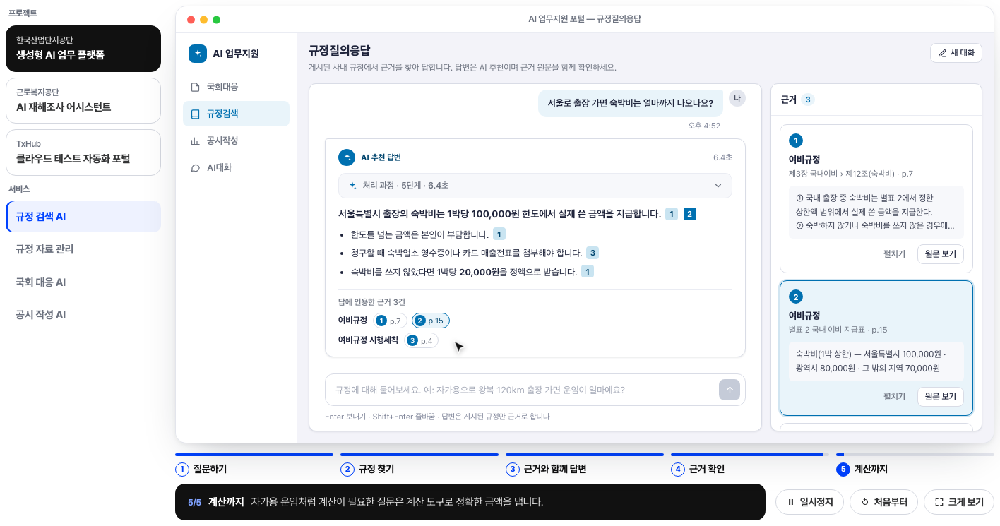
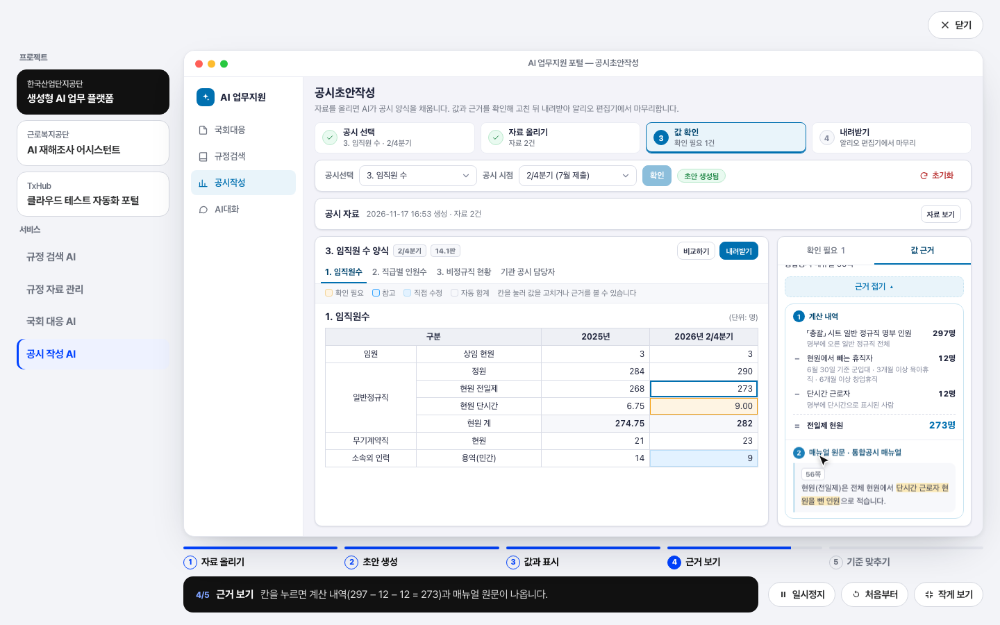
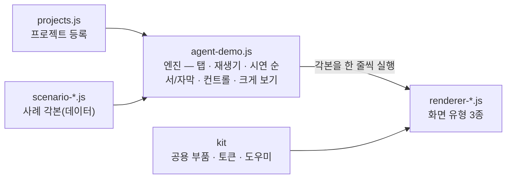

# AI 에이전트 구축 사례 시연

| 항목 | 내용 |
|---|---|
| 기간 | 2026.11 |
| 위치 | 회사 홈페이지 AI Agent Platform 소개 페이지 — 구축 사례(Use Cases) 섹션 |
| 역할 | **설계·개발 전체** — 시연 엔진, 화면 유형 렌더러 3종, 사례 각본 3건, 반응형 배치·크게 보기 |
| 스택 | JavaScript(ES5, 라이브러리 없음) · CSS · Thymeleaf 프래그먼트 · Spring Boot · Claude Code |
| 직접 보기 | **[▶ 프로젝트 시연 페이지](https://imahost.github.io/portfolio/demo/)** |

실제 구축한 AI 서비스가 일하는 모습을 영상 파일 대신 HTML·CSS·JS로 재연한 섹션입니다. 방문자가 섹션에 들어오면 질문 → 처리 과정 → 근거 → 답변이 실제 화면처럼 자동으로 재생됩니다.

| 평소 배치 (왼쪽 목록 + 앱 창 + 시연 순서·자막) | 크게 보기 |
|---|---|
|  |  |

---

## 1. 영상이 아니라 코드로 재연한 이유

- **선명하다**: 화면 속 글자가 실제 텍스트라 어떤 화면 폭에서도 깨지지 않습니다.
- **고치기 쉽다**: 질문·답·수치가 각본 데이터라, 재녹화·편집 없이 데이터만 바꾸면 됩니다.
- **늘리기 쉽다**: 사례 파일 하나를 더하면 탭이 하나 생깁니다.
- **폭에 맞춘다**: 앱 창 폭에 따라 화면 배치를 바꿔 데스크톱·태블릿·휴대폰에서 같은 시연을 봅니다.

## 2. 담은 사례

| 프로젝트 | 서비스 | 화면 유형 | 시연 순서 |
|---|---|---|---|
| 한국산업단지공단 · 생성형 AI 업무 플랫폼 | 규정 검색 AI | `rag-chat` | 질문하기 → 규정 찾기 → 근거와 함께 답변 → 근거 확인 → 계산까지 |
| 〃 | 국회 대응 AI | `draft-workspace` | 초안 요청 → 근거 검색 → 초안 작성 → 근거 확인 → 사람이 확인 |
| 〃 | 공시 작성 AI | `form-draft` | 자료 올리기 → 초안 생성 → 값과 표시 → 근거 보기 → 기준 맞추기 |

화면 속 규정·요구서·수치는 모두 시연용 예시 데이터입니다.

## 3. 구조



각본은 "무엇을 할지"만 적은 데이터이고, 화면을 그리는 일은 화면 유형(렌더러)이 맡습니다.

```js
{ do: 'chapter', n: 2 },                               // 시연 순서 3번째 장으로
{ do: 'cursor', to: 'suggest:0', click: true },        // 가짜 커서가 추천 칩으로 이동해 클릭
{ do: 'write', lines: DRAFT_LINES.slice(0, 5), every: 700 },  // 편집기에 한 줄씩 작성
```

- 렌더러는 `mount(화면, 각본) → { reset, target, actions }` 하나만 지키면 됩니다. 엔진은 각본 줄의 `do`를 렌더러의 `actions`로 넘기고, 커서 목표는 `target(key)`로 묻습니다.
- 기다림은 모두 엔진의 `sleep`을 거쳐서 일시정지·처음부터·탭 전환이 각본 중간 어디서든 바로 먹힙니다.

## 4. 신경 쓴 것

- **기존 사이트를 건드리지 않기**: 섹션은 자기 CSS·JS를 직접 불러오는 프래그먼트 하나라 페이지에 한 줄 넣으면 동작합니다. 사이트 공통 CSS의 전역 리셋을 섹션 범위 안에서 되돌리고, 클래스는 `agd-` 접두어로 가뒀습니다. 기존 메뉴 스크롤 스파이가 보는 구간 밖에 섹션을 둬 메뉴 강조가 바뀌지 않게 했습니다.
- **보일 때만 재생**: 섹션이 화면에 충분히 보일 때만 재생하고, 브라우저 탭이 숨으면 멈춥니다.
- **배치는 앱 창 폭 기준**: 뷰포트가 아니라 앱 창 폭(1000 · 700px)으로 배치를 바꿔서, 크게 보기로 창이 넓어지면 그 폭에 맞는 배치가 됩니다.
- **크게 보기**: iOS Safari가 요소 전체 화면을 지원하지 않아 화면 덮기 방식으로 만들었습니다. ESC로 닫고, 열려 있는 동안 포커스를 창 안에 가두고, 닫으면 원래 스크롤 위치로 돌아옵니다.
- **접근성**: 탭은 방향키로 이동하고, 모션 줄이기 설정이면 애니메이션 없이 최종 화면을 바로 보여 줍니다. 화면 글은 모두 `textContent`로 넣어 HTML을 해석하지 않습니다.

## 5. 일하는 방식

공통 CSS·JS를 여러 화면이 같이 쓰는 사이트라 한 군데를 고치면 다른 화면이 깨지기 쉬워서, Claude Code에 작업 규칙을 두고 **설계 문서 → 구현 → 사이드이펙트 점검** 순서로 진행했습니다.

- 설계 문서 3건: 시연 섹션 추가, 사례 추가(국회 대응·공시 작성), 보기 개선(한 화면 배치·크게 보기)
- 구현 중 나온 설계 구멍·애매한 요구는 이슈 로그에 먼저 적고, 의도가 분명한 작은 것만 바로 고치고 나머지는 결정을 받았습니다.
- 구현 뒤에는 구현과 분리된 점검 에이전트가 공통 파일 영향·포함 관계·반응형 기준폭을 확인하고, 결과를 설계 문서에 남깁니다.

## 6. 포트폴리오 시연 페이지

[시연 페이지](https://imahost.github.io/portfolio/demo/)(`demo/`)는 홈페이지의 시연 파일을 복사하되 제가 만든 사례만 남겼고, 사이트 전제(고정 헤더 높이·플로팅 버튼 자리·공통 리셋)만 `demo/portfolio.css`에서 덮어썼습니다. 같은 엔진에 렌더러를 더해 포트폴리오의 다른 프로젝트(규정 자료 관리·근로복지공단·TxHub)도 시연으로 만들었습니다. 주소 끝에 `#프로젝트id`를 붙이면 그 시연이 바로 열립니다.
