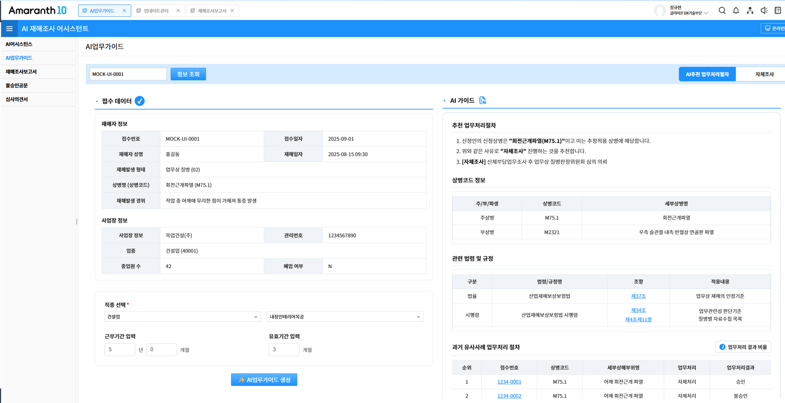
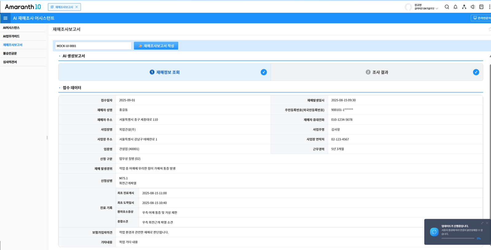
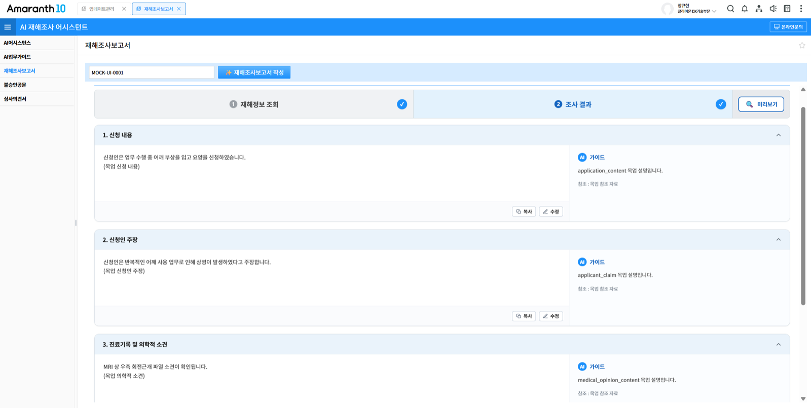
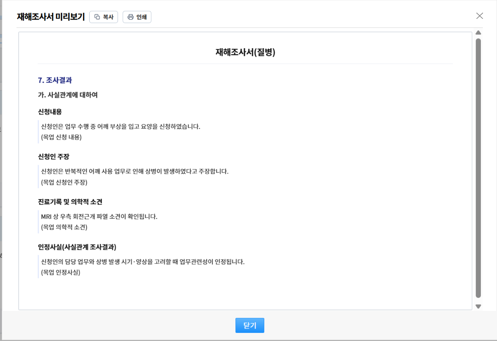
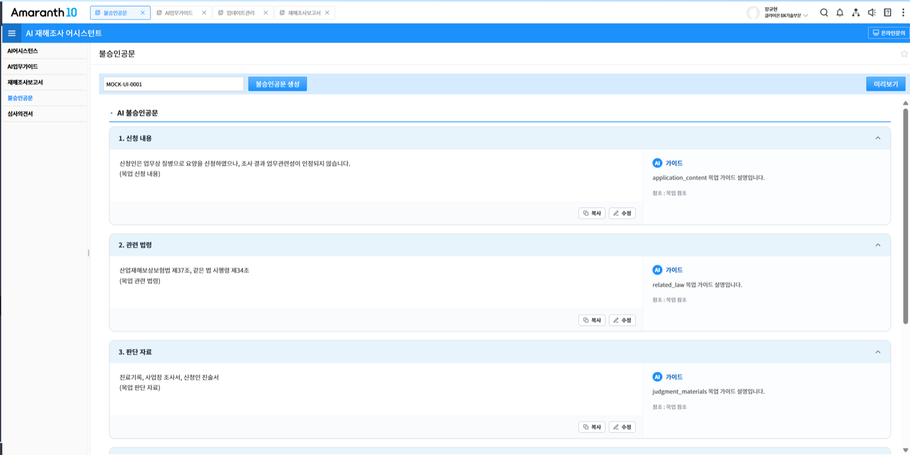
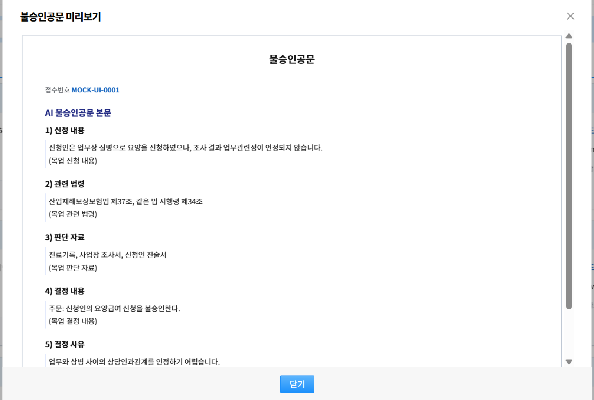
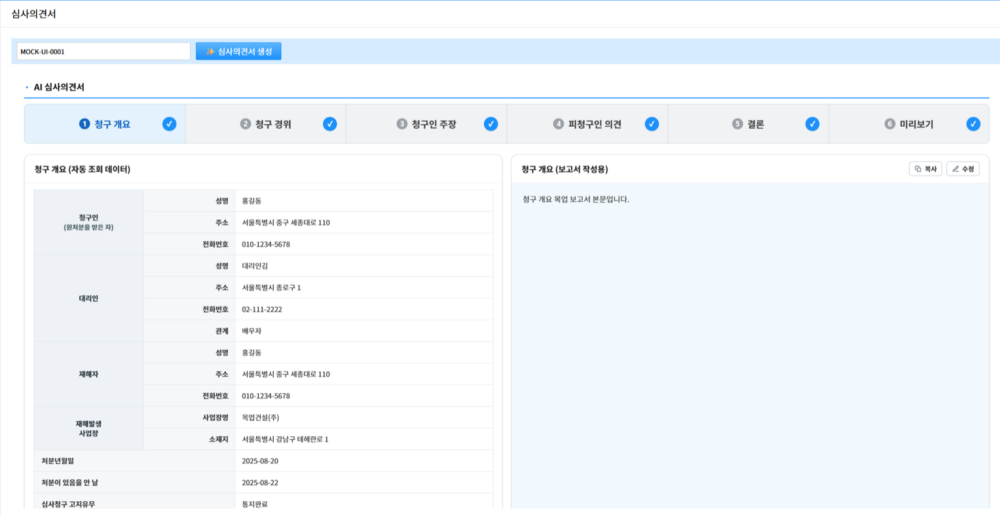

# 근로복지공단 AI 재해조사 어시스턴트 (내부 업무 시스템)

| 항목 | 내용 |
|---|---|
| 기간 | 2025.10 – 2026.03 |
| 제품 | 산재 요양 신청 건의 조사·심사 업무를 돕는 **AI 어시스턴트**. 더존 **Amaranth 10** 업무 포털 안의 메뉴로 동작하는 내부 시스템 |
| 역할 | 프론트엔드 개발 — 접수 데이터 조회부터 AI 생성 문서의 검토·수정·미리보기·인쇄까지의 화면 흐름 구현 |
| 스택 | React · TypeScript · 더존 프레임워크(Amaranth 10) · LLM 생성 API 연동 |

담당자가 접수번호 하나를 넣으면 접수 데이터를 불러오고, AI가 업무처리 절차 추천과 보고서·공문·의견서 초안을 만듭니다. 담당자는 항목별로 **AI 가이드(근거·참조)** 를 보면서 내용을 수정하고, 완성본을 미리보기·인쇄합니다.

---

## 1. 화면

> 사내 시험 환경의 더미 데이터(`MOCK-UI-0001`)로 캡처했습니다. 실제 재해자 정보는 들어 있지 않습니다.

### AI 업무가이드
접수 데이터(재해자·사업장 정보)와 직종·근무기간을 입력하면 추천 업무처리 절차, 상병코드 정보, 관련 법령·조항, 과거 유사 사례의 처리 결과를 보여 줍니다.

### 재해조사보고서
2단계(재해정보 조회 → 조사 결과)로 진행합니다. 조사 결과는 항목(신청 내용·신청인 주장·진료기록 및 의학적 소견·인정사실)마다 AI 초안과 가이드를 나란히 두고 복사·수정할 수 있습니다.

| 1단계 — 재해정보 조회 | 2단계 — 조사 결과 |
|---|---|
|  |  |

| 재해조사서 미리보기 (복사·인쇄) |
|---|
|  |

### 불승인공문 · 심사의견서

| 불승인공문 (항목별 AI 초안 + 가이드) | 불승인공문 미리보기 |
|---|---|
|  |  |

| 심사의견서 — 6단계 작성(청구 개요 → 청구 경위 → 청구인 주장 → 피청구인 의견 → 결론 → 미리보기) |
|---|
|  |

---

## 2. 화면 설계에서 신경 쓴 것

- **AI 초안과 근거를 나란히**: 생성된 문장만 보여 주면 담당자가 믿고 쓰기 어렵습니다. 항목마다 오른쪽에 AI 가이드(설명·참조 자료)를 붙여, 어디서 온 내용인지 보고 고치게 했습니다.
- **항목 단위 수정·복사**: 문서 전체를 다시 생성하지 않고 항목 하나만 고치거나 기존 시스템에 붙여 넣을 수 있게 했습니다.
- **단계형 진행 표시**: 보고서 2단계, 심사의견서 6단계처럼 긴 작성 흐름을 단계 표시줄로 보여 주고, 완료된 단계는 체크로 표시합니다.
- **자동 조회 데이터와 작성용 본문 분리**: 심사의견서의 청구 개요처럼 시스템에서 가져온 데이터와 AI가 쓴 보고서 본문을 좌우로 나눠, 원천 데이터를 실수로 고치지 않게 했습니다.
- **미리보기·인쇄**: 완성본을 실제 서식(재해조사서·불승인공문)으로 미리 보고 바로 인쇄합니다.

---

## 3. 일하는 방식

- Amaranth 10 포털의 탭·메뉴 체계 안에서 동작해야 해서, 더존 프레임워크의 화면 규약(탭 열기·즐겨찾기·공통 헤더)에 맞춰 구현했습니다.
- Cursor·Claude를 화면 구현·리팩터링·리뷰에 활용했습니다.

<!-- TODO: 맡은 화면 범위(5개 메뉴 중), LLM 연동 방식(백엔드 담당 여부), 성과가 있으면 추가 -->
