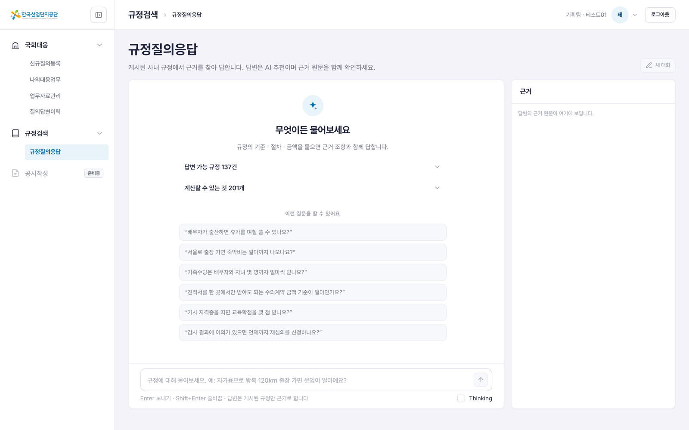
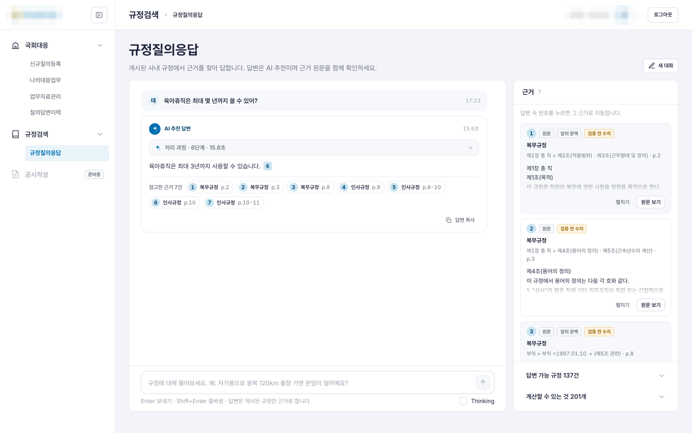
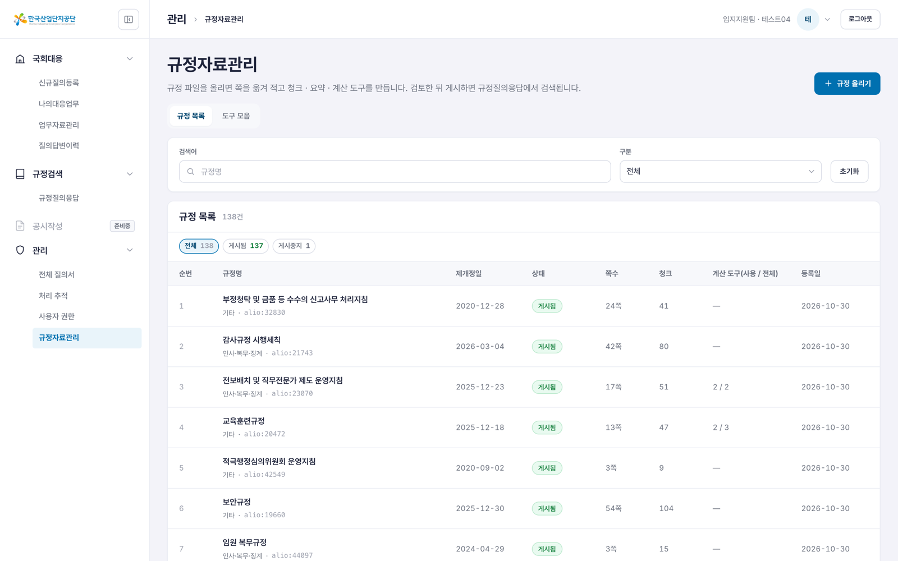
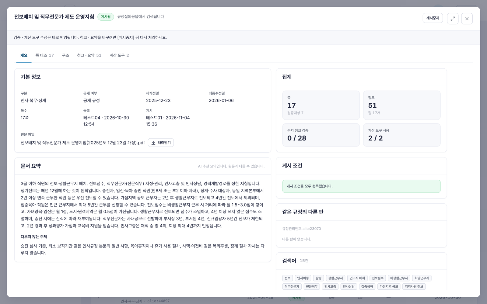
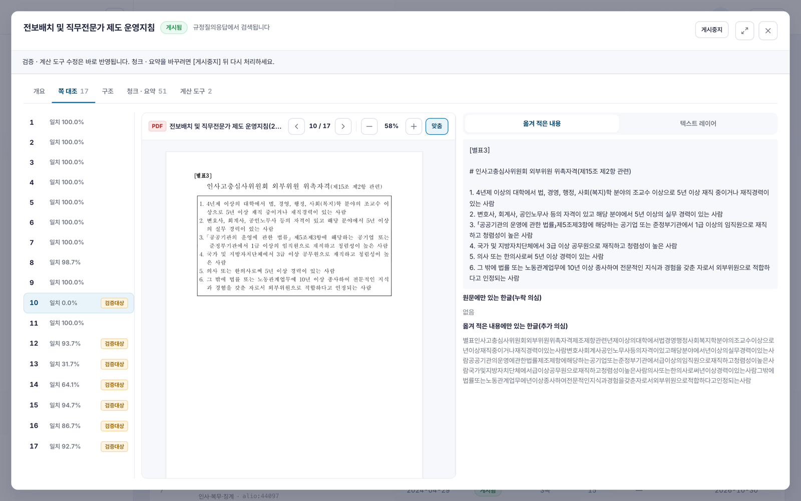
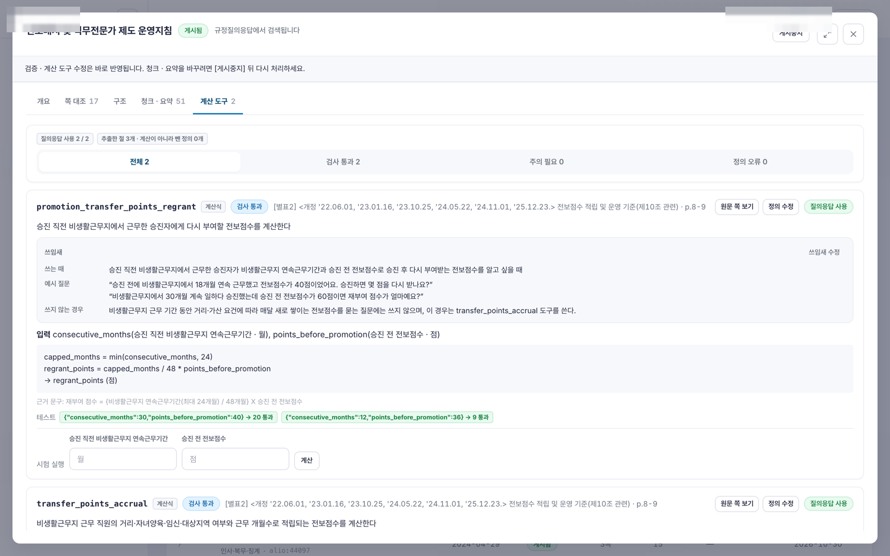
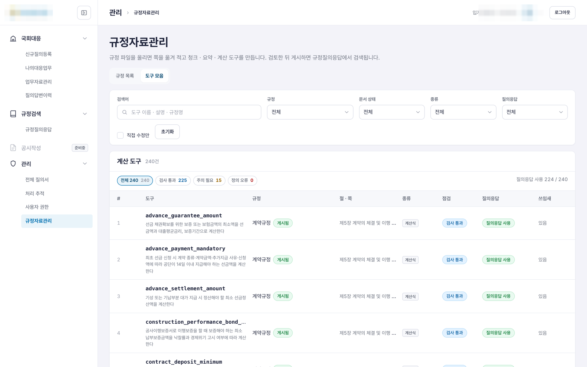
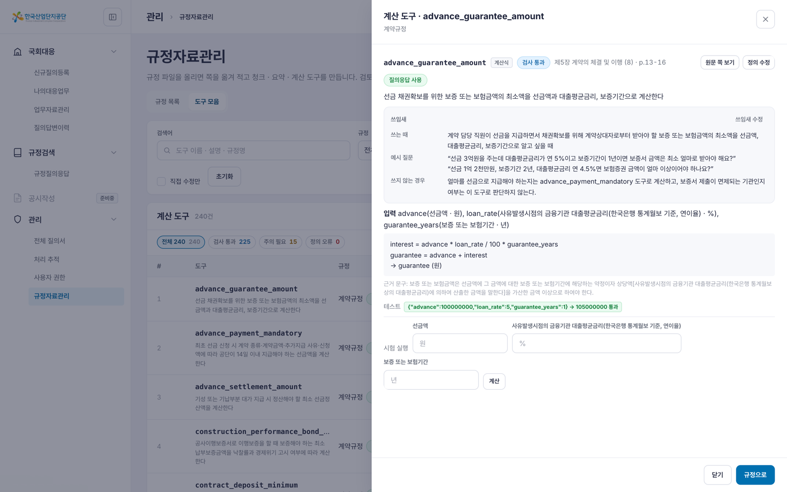
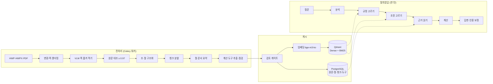

# 한국산업단지공단 규정검색 RAG PoC

| 항목 | 내용 |
|---|---|
| 기간 | 2026.10 – 2026.11 |
| 발주 | 한국산업단지공단 — 생성형 AI 실증(PoC) 플랫폼의 서비스 하나 |
| 역할 | **규정검색 모듈 전체** — 설계 문서, 백엔드(전처리·검색·질의응답·계산 도구), 프론트엔드(규정질의응답·규정자료관리). 로그인·권한·배포 같은 공통 프레임워크는 다른 담당자 |
| 규모 | 규정 138건 · 절 1,592개 · 청크 7,989개 · 계산 도구 240개(사용 224개) |
| 스택 | Python 3.12 · FastAPI · Celery · PostgreSQL · Redis · Qdrant · bge-m3-ko · Kiwi · vLLM(사내 GPU LLM) · Claude API · React · TypeScript · Docker |

공단 직원이 "출장 가면 일비 얼마예요?" 같은 질문을 하면, 게시된 사내 규정에서 근거 조항을 찾아 답하고, 규정에 계산식이 있으면 값을 물어 계산까지 해 주는 서비스입니다.

---

## 1. 화면

### 규정질의응답

| 첫 화면 | 답변 화면 |
|---|---|
|  |  |

- 답변 속 번호 `[6]`을 누르면 오른쪽 근거 카드로 이동합니다. 근거 카드는 규정명·조항 경로·쪽 번호·원문을 보여 주고, 원문 쪽 이미지를 바로 열 수 있습니다.
- "검증 전 수치" 배지: 전처리 단계에서 사람이 아직 확인하지 않은 쪽의 숫자라는 표시입니다. 답을 그대로 믿지 않도록 화면에서 알려 줍니다.
- "처리 과정 · 6단계 · 15.6초"를 펼치면 어떤 규정을 골랐고 어떤 조항을 읽었는지 단계별로 보입니다.

### 규정자료관리 (관리자)

| 규정 목록 | 규정 개요 |
|---|---|
|  |  |

| 쪽 대조 (원문 PDF ↔ 옮겨 적은 글) | 규정의 계산 도구 |
|---|---|
|  |  |

| 도구 모음 | 도구 상세 (시험 실행) |
|---|---|
|  |  |

---

## 2. 전체 구조



데이터는 PostgreSQL이 원본(문서·쪽·절·청크·도구)이고, Qdrant는 PostgreSQL에서 언제든 다시 만들 수 있는 검색 색인입니다. Redis는 대화 상태(TTL 1시간)와 작업 락에만 씁니다.

---

## 3. 전처리 파이프라인 (8단계)

| 단계 | 하는 일 | 설계 포인트 |
|---|---|---|
| 변환·렌더링 | HWP·HWPX·PDF → 쪽 이미지 | HWP는 정부·공공기관 문서의 대부분. 텍스트 추출이 아니라 **쪽 이미지**로 통일해 표·별표·서식을 잃지 않음 |
| 쪽 옮겨 적기 | VLM(비전 LLM)이 쪽 이미지를 마크다운으로 | 같은 문장 반복(LLM 루프) 감지 → 재시도, 쪽마다 독립 호출이라 실패 쪽만 다시 처리 |
| 원문 대조 | PDF 텍스트 레이어와 한글 일치율 비교 | 일치율 0.97 미만이면 "검증대상"으로 표시해 사람이 확인(위 쪽 대조 화면). 스캔본처럼 텍스트 레이어가 없으면 대조 불가로 분리 |
| 구조화 | 장·조·항·별표·서식을 절(section)로 | 조문 번호(`제N조의M`)를 정규식으로 잡아 절 경계를 만들고, 별표·서식은 본문 조와 연결 |
| 청크 분할 | 절 안에서 토큰 기준으로 나눔 | 청크 머리말에 `규정명 > 장 > 조` 경로를 붙여 임베딩 입력에 맥락을 포함 |
| 요약 | 절 요약(다루는 것·다루지 않는 것·키워드·예상 질문), 문서 요약 | "다루지 않는 것"을 따로 뽑아 검색에서 헷갈리는 규정을 걸러냄 |
| 계산 도구 추출 | 규정의 수식·표를 실행 가능한 도구 정의로 | 5절에 따로 적었습니다 |
| 점검 | 도구 형식·중복·테스트·근거 수치 자동 검사 | 사람이 전수 검토할 수 없는 양이라 기계 점검을 먼저 통과시킴 |

실측 비용(사내 GPU LLM 기준): 문서 1건당 중앙값 약 62K 토큰, 138건 전체 약 9시간.

---

## 4. 하이브리드 검색

| | 의미 검색 (Dense) | 낱말 검색 (Sparse / BM25) |
|---|---|---|
| 모델 | bge-m3-ko, 1024차원 | Kiwi 형태소 분석 → 명사·숫자·외래어만(NNG·NNP·NR·SN·SL) |
| 잘 잡는 것 | "회사 돈으로 차 타고 가면" → 여비규정 자가용 운임 | "제15조의2", "직무연봉", 고유 용어 |
| 보강 | 청크 머리말(조항 경로)을 입력에 포함 | 조문 번호 앵커, 사용자 사전(규정 고유 용어), k1 1.2 / b 0.75, 포인트 종류별 avgdl 분리 |

- 두 결과를 **RRF(k=60)** 로 합칩니다. 점수 척도가 다른 두 검색을 순위로만 섞어서 튜닝 없이도 안정적입니다.
- **검색 포인트 6종**: 문서 요약 · 예상 질문 · 도구 쓰임새(→ 규정 고르기용), 절 요약 · 청크 · 양식(→ 조항 고르기용). 한 규정이 여러 각도로 검색되게 해서 질문 표현이 규정 문장과 달라도 걸립니다.
- 검색은 두 단계입니다. 먼저 **규정을 고르고**(후보 20건 → LLM이 최대 3건 선택), 고른 규정 안에서만 **조항을 고릅니다**(청크 20 + 절 요약 10 → LLM이 최대 6개 선택). 138건 규정 전체에서 청크를 바로 찾는 것보다 엉뚱한 규정이 섞이는 일이 크게 줄었습니다.

---

## 5. 규정 기반 계산 도구

규정에는 "재부여 점수 = {연속근무기간(최대 24개월) / 48개월} × 승진 전 전보점수" 같은 식이 많습니다. LLM이 매번 암산하면 틀리기 쉬워서, **전처리 때 식을 도구로 뽑아 두고 질의응답 때는 실행기가 계산**합니다.

```
입력  consecutive_months(월), points_before_promotion(점)
capped_months = min(consecutive_months, 24)
regrant_points = capped_months / 48 * points_before_promotion
테스트  {"consecutive_months":30,"points_before_promotion":40} → 20
```

- **자동 점검**: 형식 오류·이름 중복·테스트 실패는 오류, 테스트 없음·근거에 없는 숫자는 주의. 주의 중에서도 근거 없는 숫자가 있는 도구는 질의응답에 쓰지 않습니다.
- **근거 대조**: 식의 숫자(24, 48)가 규정 원문에 있는지 확인합니다. 억·천만 단위 금액, "1년 6개월 → 18" 같은 기간 변환, "N분의 M" 분수까지 원문 표기와 맞춰 봅니다.
- **쓰임새**: 도구마다 "쓰는 때·예시 질문·쓰지 않는 경우"를 생성해 검색 포인트로 넣습니다. 비슷한 도구(적립 vs 재부여)를 질문에 맞게 고르는 근거가 됩니다.
- **되묻기**: 질문에 자기 경우("18개월 근무했고 40점이었어요")가 있으면 값을 읽어 계산하고, 없으면 답을 먼저 한 뒤 계산을 제안합니다. 값이 모자라면 최대 2개까지 되묻습니다.

---

## 6. 답변 품질을 위해 한 것

| 문제 | 대응 |
|---|---|
| 근거에 없는 인용 번호를 답에 씀 | 답변 뒤 인용 번호를 근거 목록과 대조해 없는 번호는 지우고, 수치가 붙은 문장은 근거 문장과 맞춤 |
| 분수를 "3분의 1"로 지어냄 | 근거에 있는 분수 중 분모가 같은 것으로 바로잡음 |
| 근거 글이 너무 길어 LLM이 흐름을 놓침 | 절 하나 ≤ 4,000자, 전체 ≤ 12,000자, 목차 ≤ 14,000자 상한. 다시 찾기는 1회만 |
| 범위 밖 질문("제 복지포인트 잔액은?") | 분석 단계에서 범위 밖·개인정보 질문을 가려 사번 등을 묻지 않음 |
| 판단 단계의 비용·지연 | 판단 단계(분석·고르기)는 512토큰·사고 끄기, 답변만 4,096토큰 |

**평가**
- 계산 골든셋 50문항: 41문항 정답(82%). 맞는 규정 선택 47, 도구 호출 46.
- 수용 시나리오 13건(규정 라우팅·멀티턴·주제 전환·범위 밖·규정 공백): 11건 통과. 실패 2건은 되묻기 기준 차이로, 설계 문서에 미결로 기록.

---

## 7. 서버 이관

로컬에서 전처리·검토를 끝낸 결과를 개발 서버로 옮길 때 전처리를 다시 돌리지 않도록 **내보내기·가져오기**를 만들었습니다.

- 내보내기: 문서마다 원본 파일 + 쪽·절·청크·요약·도구 정의(JSON)를 폴더로.
- 가져오기: 대상 서버에 넣고, 임베딩은 **대상 서버의 모델로 다시 생성**해 게시. 모델이 달라도 색인이 깨지지 않습니다.
- 검증: 138건·도구 401개(추출 기록 기준)를 옮긴 뒤 로컬과 대조. 도구 3개가 점검 결과 "오류 → 정상"으로 달라진 것을 발견했고, 원인은 내보내기가 중복 제거된 행을 쓰고 있었던 것. 추출 기록을 원천으로 바꿔 0건 불일치로 맞췄습니다.

---

## 8. 일하는 방식

- **설계 문서가 원천(SSOT)**: 화면·상태·API·DB 계약을 `docs/`에 먼저 쓰고 코드가 따릅니다. 구현 중 설계 구멍을 찾으면 코드만 고치지 않고 문서에 역반영하고 **ADR**(결정 기록)로 남겼습니다. 이 모듈에서 ADR 23건.
- **Claude Code 협업**: 프로젝트 규칙(CLAUDE.md), 영역별 전문 에이전트(docs·backend·frontend·qa), `/impact`·`/adr` 같은 작업 커맨드를 두고 AI와 같이 개발했습니다. 사람은 결정하고, AI는 전파·구현·검증을 맡는 구조입니다.
- **다른 서비스와의 충돌 방지**: 한 코드베이스에 서비스 3개가 같이 들어가서 테이블 접두어(`reg_`), 마이그레이션 가지, 권한 코드, Qdrant 별칭, API 경로를 서비스별로 분리했습니다.

---

## 9. 배운 것

- RAG 품질은 모델보다 **전처리와 검색 단위 설계**에서 더 많이 결정됐습니다. 쪽 이미지 → VLM → 원문 대조로 표와 별표를 살린 것, 검색을 규정 고르기와 조항 고르기 두 단계로 나눈 것이 가장 효과가 컸습니다.
- LLM에게 계산을 시키지 않고 **식을 데이터로 뽑아 실행기가 계산**하면, 틀리는 지점을 사람이 점검하고 고칠 수 있는 형태가 됩니다.
- 숫자 하나(골든셋 82%)보다 **어떤 유형에서 틀리는지**를 시나리오로 남기는 것이 다음 개선 방향을 정하는 데 더 유용했습니다.
