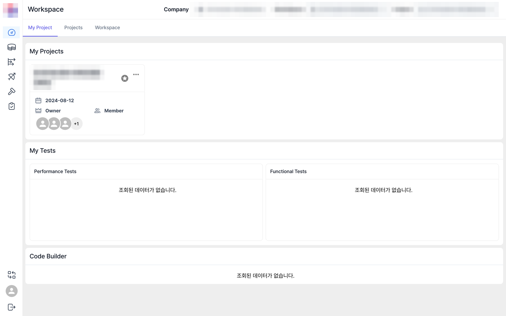
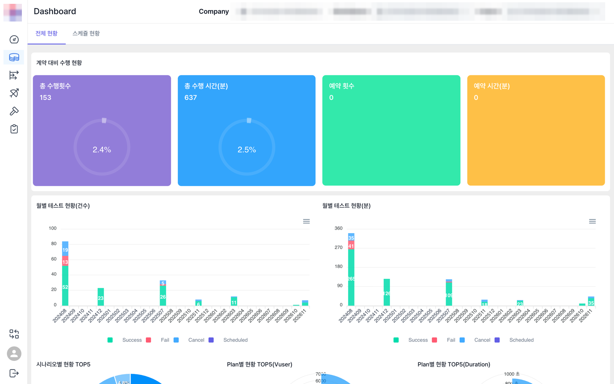
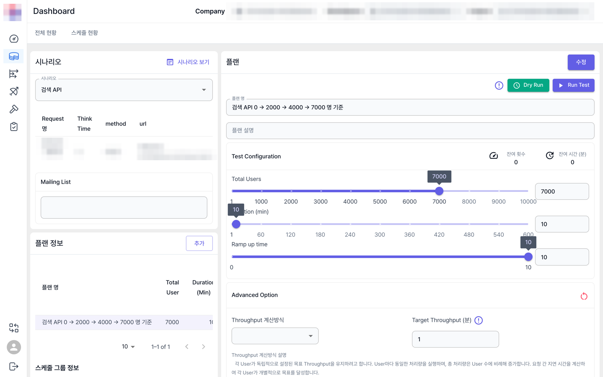
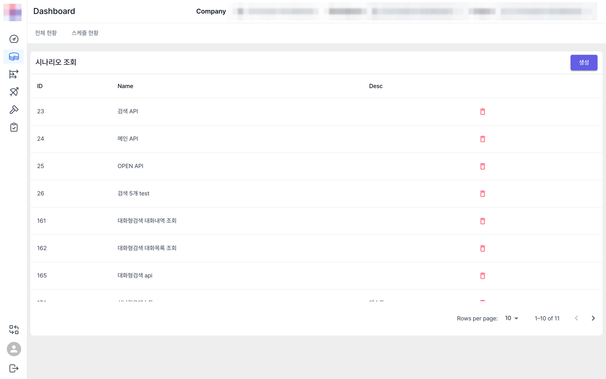
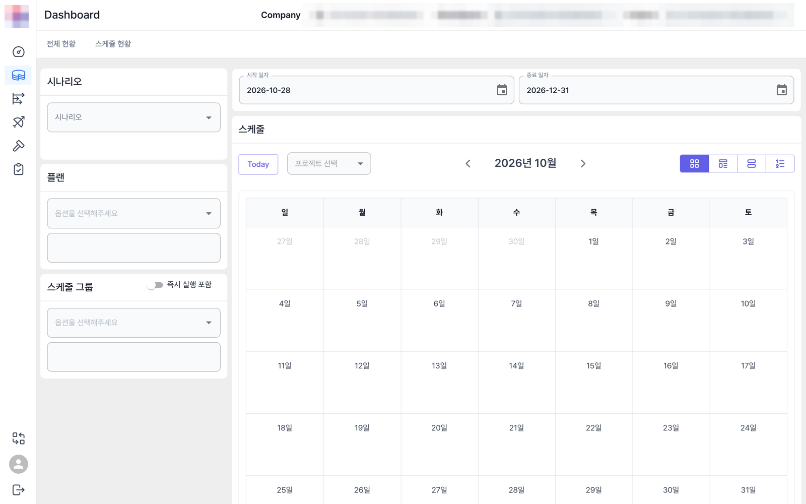
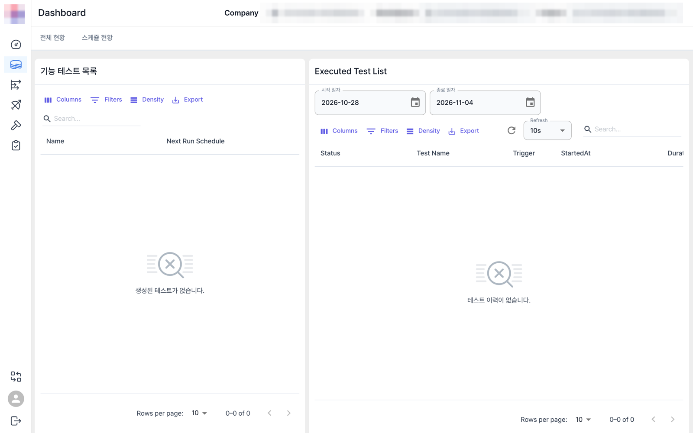
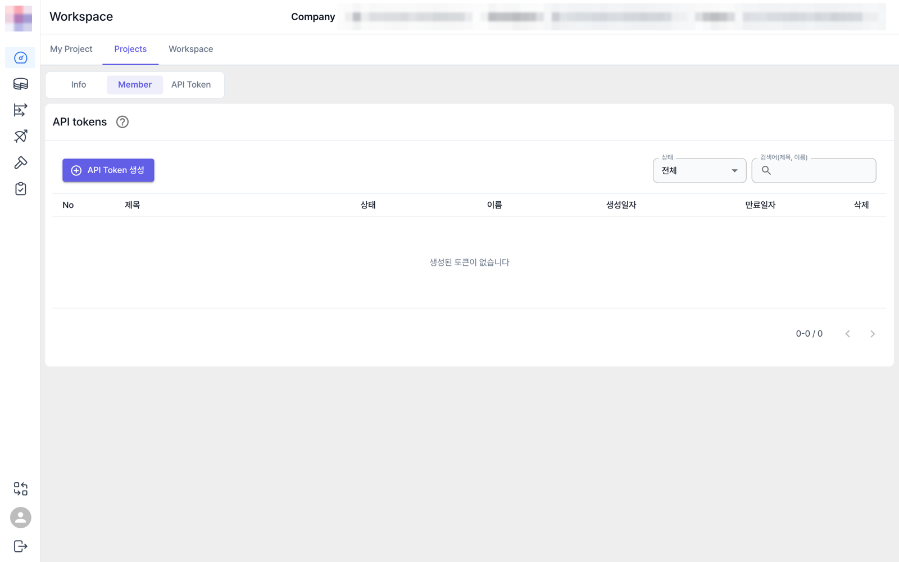
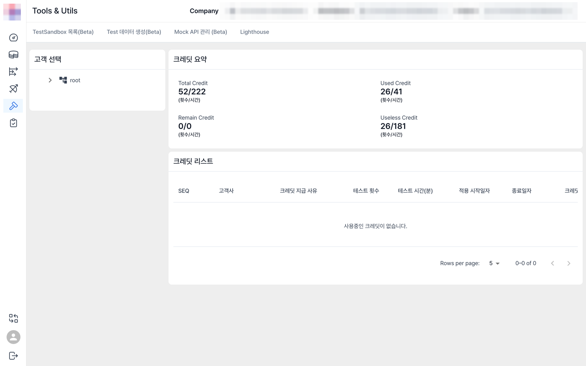
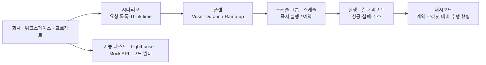

# TxHub — 클라우드 테스트 자동화(TaaS) 포털

| 항목 | 내용 |
|---|---|
| 기간 | 2024.03 – 2026.01 (주 투입 2024.03–09 · 2025.04–08, 이후 보안 조치) |
| 제품 | 성능 테스트·기능 테스트·Lighthouse·Mock API·코드 빌더를 한 포털에서 쓰는 **SaaS형 테스트 플랫폼**. 고객사가 워크스페이스·프로젝트 단위로 가입해 쓰고, 계약 크레딧(횟수·시간)만큼 테스트를 실행 |
| 역할 | 프론트엔드 개발 — 포털 전반의 화면 구현(커밋 366건), Lighthouse 서버 일부 |
| 스택 | React 18 · TypeScript · Next.js 14 · MUI · ApexCharts · Keycloak(OIDC) · Node.js(Lighthouse 서버) · Docker · Kubernetes 배포 |

---

## 1. 화면

시험 계정으로 찍은 화면이고, 고객사명·로고·개인 정보는 가렸습니다.

| 워크스페이스 (내 프로젝트·내 테스트·코드 빌더) | 대시보드 (계약 대비 수행 현황·월별 테스트 현황) |
|---|---|
|  |  |

| 성능 테스트 플랜 설정 (Vuser·Duration·Ramp-up·Throughput) | 시나리오 목록 |
|---|---|
|  |  |

| 스케줄 캘린더 | 기능 테스트 목록·실행 이력 |
|---|---|
|  |  |

| 프로젝트 API 토큰 | 고객사 크레딧 관리 |
|---|---|
|  |  |

---

## 2. 제품 구조

성능 테스트는 **시나리오 → 플랜 → 스케줄 → 결과** 네 단계로 쌓이고, 고객사에 지급된 **크레딧(횟수/시간)** 안에서만 실행됩니다. 이 구조가 화면 대부분의 공통 축이라, 시나리오·플랜·스케줄을 고르는 멀티셀렉트를 공통 컴포넌트로 만들어 캘린더·대시보드·메일링 화면이 같이 씁니다.

---

## 3. 맡아서 만든 것

| 영역 | 내용 |
|---|---|
| 워크스페이스·멤버 | 프로젝트 멤버 초대 흐름(초대 → 메일 → 가입 → 수락), 초대 중복 검색, 초대 취소 상태, 조직 선택 깊이 제한, 워크스페이스·프로젝트가 없는 사용자의 생성 유도. 멤버·API 토큰 진행률 표시 |
| 대시보드·캘린더 | 워크스페이스별 스케줄 집계, 캘린더 멀티셀렉트 조회와 플랜별 색 구분, 날짜 조회용 캘린더 |
| 성능 테스트 | 시나리오·플랜·스케줄 멀티셀렉트 공통 컴포넌트, 테스트 시나리오 작성 화면, 스케줄 전체 삭제·조회 보정, duration 한국 시간 표기 |
| 시나리오 메일링 | 테스트 결과를 받을 메일링 리스트 등록·조회 |
| 기능 테스트 | Functional Test 메뉴 신설, 결과 목록·툴팁 |
| 태스크 보드 | 프로젝트 안 task · story · comment CRUD, 히스토리 모달 |
| 크레딧·고객 관리 | 고객사 크레딧 등록·수정·삭제, 크레딧 요약(총·사용·잔여·소멸), 사업자 프로필, 계약 코드·공통 코드 연동 |
| 코드 빌더 | 운영 On/Off 토글, Code Space 연결 화면 |
| 계정 | 이메일 발송 페이지, 비밀번호 재설정(토큰 없이), 프로필 이메일을 토큰 대신 API로 조회 |
| 보안 | CSAP(클라우드 보안 인증) 취약점 점검 결과 조치(2026.01) |
| Lighthouse 서버 | PC·모바일 플래그에 따라 다른 설정으로 측정, 커스텀 환경 추가 (Node.js) |

---

## 4. 신경 쓴 것

- **긴 트리 체크박스 최적화**: 조직·고객 선택 트리에서 부모·자식 체크 상태를 한 번에 계산하도록 바꿔 큰 트리에서도 끊기지 않게 했습니다.
- **파일 다운로드 경로 통일**: 백엔드에서 받은 파일을 프런트를 거쳐 로컬에 저장하는 방식으로 정리해 브라우저별 동작 차이를 없앴습니다.
- **데이터 두 번 불러오기 제거** 같은 작은 성능 수정을 꾸준히 했습니다(코드 관리 화면 등).
- 2년에 걸쳐 투입과 이탈을 반복한 프로젝트라, 돌아올 때마다 공통 컴포넌트와 화면 규칙을 먼저 맞추고 기능을 얹는 방식으로 일했습니다.
